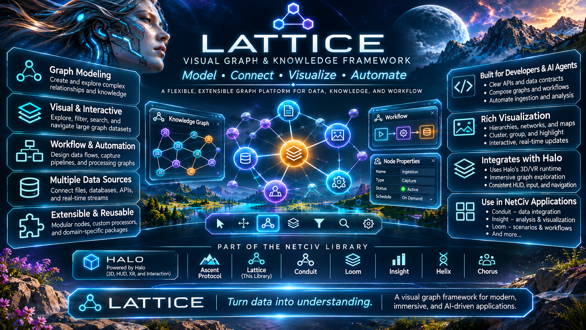

# Lattice



Lattice turns graphs, networks, and Mermaid flowcharts into interactive spatial
visualizations. It builds on [Halo](https://github.com/Rick-Boardman/vr-halo)
for the scene rig, WebGL HUD, navigation, input, and WebXR runtime.

**Apache-2.0. Developers and AI coding agents are welcome to use, modify,
distribute, and contribute.** Third-party components retain their own licenses.

## Try the included example

Install Node.js 24 and npm 11, then:

```sh
git clone https://github.com/Rick-Boardman/vr-lattice.git
cd vr-lattice
npm ci
npm start
```

Open http://127.0.0.1:8080/examples/graph/. No account, API key, private
repository, neighboring checkout, or cloud deployment is required. WebXR needs
HTTPS outside localhost and a compatible browser/device.

## What it provides

- Graph normalization, adjacency, metrics, and scene runners.
- Shared node/edge meshes, labels, card scenes, picking, and graph HUD helpers.
- Force-directed, clustered, and Mermaid flow layout.
- Configurable visual presets for workflow diagrams, topology, and relationships.

Applications own execution, persistence, integrations, and domain rules. Lattice
visualizes workflow structures; it does not execute workflows or connect databases.

## Mermaid diagrams

Turn Mermaid flowchart text into a navigable 3D diagram. Lattice can parse a
supported flowchart subset, extract the first Mermaid block from Markdown, lay out
the connections, and render labeled cards on a flat or spherical surface. Halo
supplies desktop, touch, and WebXR navigation; your application supplies controls
and selection behavior. This is useful for exploring architecture diagrams,
process flows, and diagrams written by developers or AI agents.

```js
import { parseMermaidFlowchart, renderMermaidFlowchart3d } from "@rb/lattice/mermaid";

const parsed = parseMermaidFlowchart(`flowchart LR
  Input[Source data] --> Check{Valid?}
  Check -->|Yes| Output[Result]
  Check -->|No| Review(Review)
`);
// Use your application's Three.js instance and scene.
const diagram = renderMermaidFlowchart3d({ THREE, parent: scene, parsed });
diagram.setLayoutMode("sphere"); // or "flat"
// In your frame loop: diagram.update(dt).
// When removing the diagram: diagram.dispose().
```

Support is deliberately narrower than Mermaid itself: `flowchart TB`, `TD`, and
`LR`, common node declarations, labeled links, and simple chains. The renderer
uses Lattice's card presentation and shape-based accent colors. Mermaid themes,
subgraphs, other diagram families, and exact Mermaid shape reproduction are not
provided by this adapter.

See the **[Mermaid guide](docs/mermaid.md)** for the syntax matrix, Markdown
loading, complete scene integration, layout behavior, picking, and limitations.
The included three-sphere demo demonstrates graph primitives; the guide's
Mermaid example uses the separate card-based renderer.

## Installation and releases

Download the versioned package and checksum from
[Releases](https://github.com/Rick-Boardman/vr-lattice/releases).
See [the quick start](docs/quick-start.md) for exact installation commands,
browser import maps, and a runnable example. Browser-native modules need an
import map; bundlers resolve package imports normally. Keep one Three.js instance.

The package entry point is `@rb/lattice`; `/graph`, `/mermaid`, and documented
`/src/` subpaths are also available. Halo, Three.js 0.185.1, and Troika
are application-provided peers. Lattice 0.3.1 is tested with Halo 0.3.0 and
requires WebGL 2. Browser applications consume the installed source
package through an import map; see [Browser distribution](docs/browser-distribution.md).

## Develop and contribute

```sh
npm run build
npx playwright install chromium
npm run test:browser
npm run audit:release
npm run pack:deliverable
```

Read [CONTRIBUTING.md](CONTRIBUTING.md) and [AGENTS.md](AGENTS.md).
AI-assisted contributions use the same licensing, testing, and review standards.
Report vulnerabilities privately as described in [SECURITY.md](SECURITY.md).

## Test a card graph in a headset

`@rb/lattice/testing/sphere-view.mjs` checks a card graph as a person in a headset sees it (with Halo's
`@rb/halo/testing/emulated-headset.mjs` for the session): `viewerCardBoxes` gives each card's angular box from the
viewer, `cardOverlaps` lists pairs that overlap, and `orientationAgreement` counts card pairs whose left/right and
up/down match the desktop.

## Documentation

- [Quick start](docs/quick-start.md)
- [Mermaid flowcharts in 3D](docs/mermaid.md)
- [Graph layout](src/graph/application-style-layout.md)
- [Scene effects](src/graph/scene-effects.md)
- [Browser distribution](docs/browser-distribution.md)
- [Third-party components and asset provenance](THIRD_PARTY.md)
- [Public release audit](docs/release-audit.md)
- [LICENSE](LICENSE) and [NOTICE](NOTICE)


### Desktop editing of authored graph text

Opt in at the host's existing graph/DOM input boundary. The graph scene provides
`editHitTargets` and, with `enableSavedBodyScroll: true`, `getBodyScrollTarget`.
Initialize the ordinary pick ray as usual, then call
`pickGraphDesktopTextField(scene, raycaster, preferredHit)` for authored
`title`, `body`, or `label` surfaces. Keep ports and HUD controls ahead of
graph editing in the host's hit arbitration. Return no edit target for derived
captions, forecast projections, or documents the current person cannot edit.

Create one `createInlineSceneEditor({ host: canvas, project, getMode, onCommit })`
per mounted graph. Enrich the resolved target with a host-specific unique `key`,
current document identity in `document`, and (for Notes) `multiline: true`.
Use `createSceneEditGesture()` to qualify the browser's double-click against the
same two stationary primary clicks; optionally defer normal single-click
inspector reveal with `deferInspect`. A normal selection should reveal the
Inspector **without activating a text field**. A desktop double-click can
arrive after that reveal; keep the Inspector away from the selected pointer
location and preserve that position through the second press. Still block
inline authoring during an intentional Inspector text edit or modal. For
products whose graphs overlap, honor the ordinary topmost hit rather than
editing an obscured card.

Call `editor.open(target, currentText)`,
`editor.update()` on frames, and `editor.dispose()` on unmount. Hosts validate
permissions and document identity again in `onCommit` and run their existing
domain mutation, undo and persistence path; Lattice never writes a document.

For saved Notes, call `pickGraphSavedBodyScroll({ scene, raycaster, winner, project })`
with the same ordinary node ray, and supply it to `attachGraphSavedBodyInput`
before wiring the board's desktop handlers. The returned teardown must be called
on unmount. Provide `isBlocked` so HUD, placement and XR gestures keep ownership.
No-drag clicks outside the author's active overlay still reach the host after
saving. Escape cancels; multiline Notes stay native, with Enter for a newline and
Ctrl/Command+Enter or click-away to save. A restrictive CSP host can supply
`styleNonce` to the editor (on the first use per document).

Reusable graph hosts can call `createGraphAuthoringAdapter` to map hit fields
to host names and centralize canonical entity lookup, document identity checks,
editor lifecycle, and saved-body picking. Provide `resolveField`, a canonical
`resolveEdge`, host `allowWrite`/mode checks, and `writeField` for the existing
mutation command. Use `createPassiveGraphInspector` with the same gesture and
current-selection checks. `resolveGraphInspectorFrame` shares physical docking;
choose explicitly whether the anchor itself should be avoided if no pointer
coordinate is provided. Spherical anchors remain unclamped horizontally.
