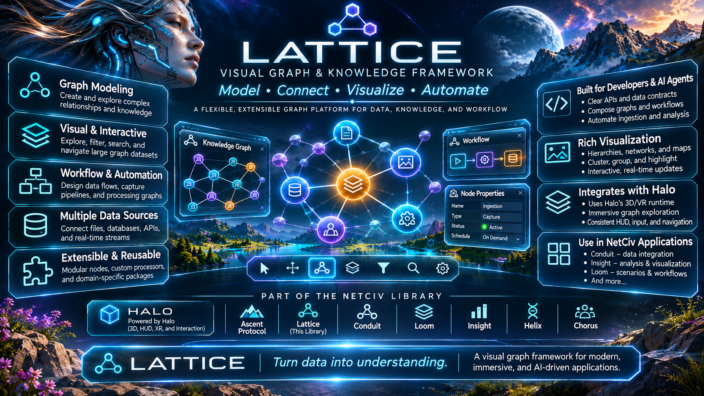

# Lattice



Lattice turns graphs, networks, and Mermaid flowcharts into interactive spatial
visualizations. It builds on [Halo](https://github.com/Rick-Boardman/vr-halo)
for the scene rig, WebGL HUD, navigation, input, and WebXR runtime.

**Apache-2.0. Developers and AI coding agents are welcome to use, modify,
distribute, and contribute.** Third-party components retain their own licenses.

## Try the included example

Install Node.js 24 and npm 11, then:

```sh
git clone https://github.com/Rick-Boardman/vr-lattice.git
cd vr-lattice
npm ci
npm start
```

Open http://127.0.0.1:8080/examples/graph/. No account, API key, private
repository, neighboring checkout, or cloud deployment is required. WebXR needs
HTTPS outside localhost and a compatible browser/device.

## What it provides

- Graph normalization, adjacency, metrics, and scene runners.
- Shared node/edge meshes, labels, card scenes, picking, and graph HUD helpers.
- Force-directed, clustered, and Mermaid flow layout.
- Configurable visual presets for workflow diagrams, topology, and relationships.

Applications own execution, persistence, integrations, and domain rules. Lattice
visualizes workflow structures; it does not execute workflows or connect databases.

## Mermaid diagrams

Turn Mermaid flowchart text into a navigable 3D diagram. Lattice can parse a
supported flowchart subset, extract the first Mermaid block from Markdown, lay out
the connections, and render labeled cards on a flat or spherical surface. Halo
supplies desktop, touch, and WebXR navigation; your application supplies controls
and selection behavior. This is useful for exploring architecture diagrams,
process flows, and diagrams written by developers or AI agents.

```js
import { parseMermaidFlowchart, renderMermaidFlowchart3d } from "@rb/lattice/mermaid";

const parsed = parseMermaidFlowchart(`flowchart LR
  Input[Source data] --> Check{Valid?}
  Check -->|Yes| Output[Result]
  Check -->|No| Review(Review)
`);
// Use your application's Three.js instance and scene.
const diagram = renderMermaidFlowchart3d({ THREE, parent: scene, parsed });
diagram.setLayoutMode("sphere"); // or "flat"
// In your frame loop: diagram.update(dt).
// When removing the diagram: diagram.dispose().
```

Support is deliberately narrower than Mermaid itself: `flowchart TB`, `TD`, and
`LR`, common node declarations, labeled links, and simple chains. The renderer
uses Lattice's card presentation and shape-based accent colors. Mermaid themes,
subgraphs, other diagram families, and exact Mermaid shape reproduction are not
provided by this adapter.

See the **[Mermaid guide](docs/mermaid.md)** for the syntax matrix, Markdown
loading, complete scene integration, layout behavior, picking, and limitations.
The included three-sphere demo demonstrates graph primitives; the guide's
Mermaid example uses the separate card-based renderer.

## Installation and releases

Download the versioned package and checksum from
[Releases](https://github.com/Rick-Boardman/vr-lattice/releases).
See [the quick start](docs/quick-start.md) for exact installation commands,
browser import maps, and a runnable example. Browser-native modules need an
import map; bundlers resolve package imports normally. Keep one Three.js instance.

The package entry point is `@rb/lattice`; `/graph`, `/mermaid`, and documented
`/src/` subpaths are also available. Halo, Three.js 0.185.1, and Troika
are application-provided peers. Lattice 0.3.0 is tested with Halo 0.3.0 and
requires WebGL 2. Browser applications consume the installed source
package through an import map; see [Browser distribution](docs/browser-distribution.md).

## Develop and contribute

```sh
npm run build
npx playwright install chromium
npm run test:browser
npm run audit:release
npm run pack:deliverable
```

Read [CONTRIBUTING.md](CONTRIBUTING.md) and [AGENTS.md](AGENTS.md).
AI-assisted contributions use the same licensing, testing, and review standards.
Report vulnerabilities privately as described in [SECURITY.md](SECURITY.md).

## Documentation

- [Quick start](docs/quick-start.md)
- [Mermaid flowcharts in 3D](docs/mermaid.md)
- [Graph layout](src/graph/application-style-layout.md)
- [Scene effects](src/graph/scene-effects.md)
- [Browser distribution](docs/browser-distribution.md)
- [Third-party components and asset provenance](THIRD_PARTY.md)
- [Public release audit](docs/release-audit.md)
- [LICENSE](LICENSE) and [NOTICE](NOTICE)
