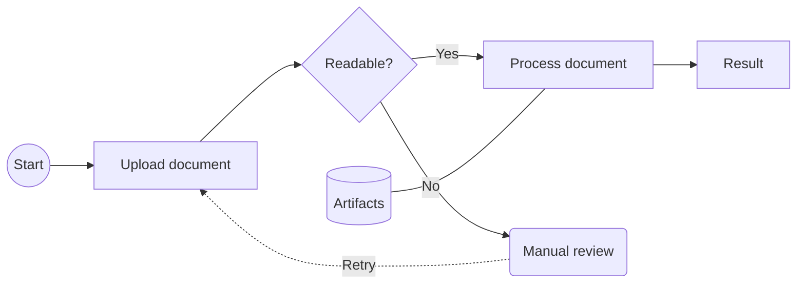
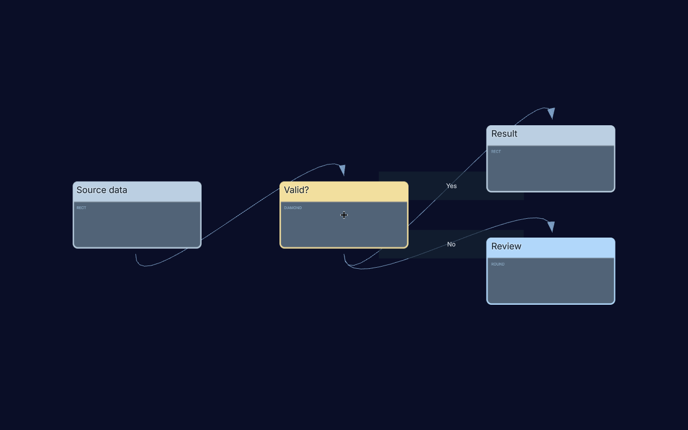

# Mermaid flowcharts in 3D

Lattice turns a supported subset of Mermaid flowchart text into a graph of
labeled 3D cards. Use it to explore software architecture, processing pipelines,
dependencies, and decision flows. A developer or AI agent can supply the text;
the same parsed graph can be displayed on a flat panel or a spherical surface.
Halo provides the surrounding scene, navigation, HUD, and WebXR plumbing.

The adapter implements its own parser and layout. You do not need the Mermaid
JavaScript package. This is a flowchart importer and spatial renderer, rather
than an embedded Mermaid SVG renderer or a workflow execution engine.

## Start with a flowchart



This produces seven nodes and seven edge records. The `-->` connections drive
the main flow layout. The store is linked by a non-flow connection, so it is
placed in a side band. The dashed retry link is displayed without determining
the main flow's layer order.

## Supported syntax

Put a `flowchart` header on the first non-empty line. Write each declaration or
edge on its own line; place comments below the header. Keep IDs to letters,
digits, underscores, and hyphens. Labels are plain text.

| Source | Parsed behavior |
| --- | --- |
| `flowchart TB` or `flowchart TD` | Top-to-bottom; `TD` normalizes to `TB` |
| `flowchart LR` | Left-to-right |
| `A` | Node with ID and default label `A` |
| `A[Task]`, `A["Task"]` | Label with shape metadata `rect` |
| `A(Review)` | Label with shape metadata `round` |
| `A((Start))` | Label with shape metadata `circle` |
| `A{Ready?}` | Label with shape metadata `diamond` |
| `A[("Artifacts")]` | Quoted database shorthand, shape metadata `db` |
| `A --> B` | Arrow, participates in main flow layout |
| `A -->\|Approved\| B` | Arrow with a label |
| `A -- Approved --> B` | Alternate arrow-label syntax |
| `A --- B` | Plain line, excluded from main flow layering |
| `A -.-> B` | Dashed connection, excluded from main flow layering |
| `A <--> B` | Two opposite `line` records, excluded from main flow layering |
| `A --> B --> C` | Simple unlabeled chain |
| `%% explanation` | Whole-line comment |

Pipe labels also work with `---`, `-.->`, and `<-->` on a single connection.
Write labeled connections on separate lines rather than inside a chain.
Bare references reuse a previously declared node's label and shape metadata.

The shape column describes **parser metadata**. The convenience renderer draws
all these nodes as cards, using the shape name as a subtitle and a different
accent color: rectangle gray-blue, rounded blue, circle green, diamond gold,
and database purple. It does not draw Mermaid's circle, cylinder, or diamond
silhouettes. A bidirectional source link becomes two plain render connections;
it is not a promise of Mermaid-style arrowheads at both ends.

## Render in a scene

Install the packages and import maps described in the [quick start](quick-start.md).
For a browser running this checkout, the following can replace
[`examples/graph/main.js`](../examples/graph/main.js); it uses that example's
existing HTML and import map. In a consuming application, replace the two relative
Lattice imports with `@rb/lattice` and `@rb/lattice/mermaid` respectively, and
provide their browser import-map entries if you are not using a bundler.

```js
import * as THREE from "three";
import { createGraphSceneContext } from "../../src/graph/index.js";
import { parseMermaidFlowchart, renderMermaidFlowchart3d } from "../../src/mermaid/index.js";
import { renderHudFrame, startAnimationLoop } from "@rb/halo";

const source = `flowchart LR
  Input[Source data] --> Check{Valid?}
  Check -->|Yes| Output[Result]
  Check -->|No| Review(Review)
`;
const parsed = parseMermaidFlowchart(source);
const ctx = createGraphSceneContext({
  THREE,
  canvas: document.getElementById("c"),
  hud: {
    uiPreset: "minimal", visibleWindowKeys: [],
    ensureHelpWindow: false, ensureSelectionWindow: false,
    applyStandardLayout: false, hideDemoWindows: false,
  },
});
const diagram = renderMermaidFlowchart3d({ THREE, parent: ctx.scene, parsed });

// The diagram starts in the XY plane. Frame it from the front; its root and
// parent scene have no transforms in this example.
function frameFlatDiagram() {
  const bounds = diagram.getFlatBounds(new THREE.Box3());
  const center = bounds.getCenter(new THREE.Vector3());
  const size = bounds.getSize(new THREE.Vector3());
  const tan = Math.tan(THREE.MathUtils.degToRad(ctx.camera.fov / 2));
  const distance = Math.max(size.y / 2, size.x / (2 * ctx.camera.aspect)) / tan;
  ctx.look.setYaw(0);
  ctx.look.setPitch(0);
  ctx.look.state.roll = 0;
  ctx.look.applyLook();
  ctx.rig.player.position.set(center.x, center.y, bounds.max.z + distance * 1.2);
}
frameFlatDiagram();
window.addEventListener("resize", frameFlatDiagram);
startAnimationLoop({
  renderer: ctx.renderer, THREE, maxDelta: 0.05,
  onFrame: ({ dt }) => {
    diagram.update(dt);
    renderHudFrame({ ...ctx, dt });
  },
});

// On application teardown, stop the frame loop, remove the resize listener,
// and call diagram.dispose(). Dispose the scene context/Halo resources you own.
```



The screenshot shows the scene example above rendered by Lattice, including
decision labels and the adapter's shape-based card accents.

This example has no HUD panels. Drag to look around and use Halo's movement
keys. Your application can add Help, selection details, and view controls as in
the graph demo. Sharing the same Three.js instance with Halo is required.

## Load from a file or Markdown

`fetchMermaidSourceText` returns text; it does not parse it or detect its format.
The default fetch cache mode is `no-store`; unsuccessful HTTP responses throw.
Normal browser origin/CORS rules apply. Pass only a URL that your application
intends to fetch; the helper adds no authentication or URL allowlist.

````js
import {
  fetchMermaidSourceText,
  extractFirstMermaidBlock,
  parseMermaidFlowchart,
} from "@rb/lattice/mermaid";

// Plain Mermaid text, for example a .mmd file served by your application:
const text = await fetchMermaidSourceText("/diagrams/review.mmd");
const parsed = parseMermaidFlowchart(text);

// Or a Markdown file containing a fenced ```mermaid block:
const markdown = await fetchMermaidSourceText("/docs/architecture.md", { cache: "default" });
const source = extractFirstMermaidBlock(markdown);
if (source === null) throw new Error("No Mermaid block found");
const fromMarkdown = parseMermaidFlowchart(source);
````

The extractor returns the **first** triple-backtick Mermaid block or `null`.
It is a small fence scanner, not a full Markdown parser. Multiple diagrams,
alternative fence styles, and document navigation belong in the host application.

## API and lifecycle

All four functions below are exported by `@rb/lattice/mermaid`.

| Function | Result |
| --- | --- |
| `parseMermaidFlowchart(source)` | `{ direction, nodes, edges }`; synchronous, no rendering or network |
| `renderMermaidFlowchart3d({ THREE, parent, parsed })` | Adds a diagram group to `parent`; returns the controller below |
| `extractFirstMermaidBlock(markdownText)` | First Mermaid code block's contents, or `null` |
| `fetchMermaidSourceText(url, { cache = "no-store" } = {})` | Promise of fetched text |

Parsed nodes have `{ id, label, shape }`. Parsed edges have
`{ from, to, label, style, layoutIgnore }`, where `style` is `arrow`, `line`,
or `dash`. The Mermaid parsed model differs from the generic canonical graph
model; pass it directly to the Mermaid renderer.

| Controller member | Use |
| --- | --- |
| `group` | Diagram root object; position/scale it as a unit |
| `nodeMeshes` | Map of node ID to its Three.js node object, for application-owned picking |
| `getFlatBounds(targetBox?)` | Bounds of the flat layout in diagram-local coordinates; not spherical/world bounds |
| `setLayoutMode("flat")` | Arrange cards in a flat XY panel; initial mode |
| `setLayoutMode("sphere")` | Place the same graph on the configured spherical surface |
| `update(dt)` | Refresh placement, connections, and highlights in the frame loop |
| `dispose()` | Remove the group and release its graphics resources |

`setLayoutMode` is immediate; the adapter does not supply an animated transition,
a mode-switch button, camera framing, or a selection HUD. Wire controls and
raycasting in the host application, using Halo's shared input helpers where
appropriate. Raycast recursively against `nodeMeshes` values to reach their
child geometry. The returned adapter does not expose all the editing and
selection methods of the underlying card scene.

The spherical preset has center `(0, 7.5, -6)`, radius `22`, yaw span `1.08π`,
and pitch span `0.56π`, in diagram-local coordinates. The convenience function
does not accept a sphere-configuration argument. Camera placement for the
spherical view belongs to the host; the flat framing example is only for flat
mode. Use lower-level graph helpers when you need custom presentation or layout.

## Layout behavior and limits

- Arrow edges determine layers; ordering within a layer attempts to reduce
  crossings. Non-arrow connections do not drive the main layer order.
- Nodes connected only by non-flow links are placed in a side band near their
  neighbors. Disconnected nodes and cycles are accepted; cyclic nodes left
  unlayered fall back to layer zero, so inspect dense or cyclic layouts.
- The Mermaid adapter uses Lattice's own `layoutFlow`, not Mermaid's SVG layout
  or the Dagre layout used elsewhere in Lattice. Positions need not match a
  Mermaid preview.
- There is no fixed graph-size limit in this adapter. Rendering and label costs
  grow with the diagram; measure on your target browser/headset. No maximum
  comfortable diagram size or physical-headset performance is established here.

Not supported as Mermaid features: sequence/class/state/ER/Gantt/pie and other
diagram families; subgraphs and nesting; `graph` headers; `RL`/`BT` directions;
class/style/linkStyle directives and themes; click callbacks; rich HTML or
Markdown labels; the full shape catalog; semicolon-separated statements;
branch shorthand such as `A & B --> C`; and labeled multi-edge chains.
The quoted database form above is recognized; `A[(Database)]` without quotes
is treated as an ordinary rectangle label by the current parser.

Unsupported text may be ignored **or misinterpreted as nodes**, rather than
producing a diagnostic. Parsing throws if it finds no nodes, but success does
not certify that the entire source was understood. Check parsed IDs, labels,
edge counts, and directions when importing an existing diagram or accepting
AI-generated text. Keep the supported header first: a comment before it prevents
the current header scan from reading the requested direction.

For Mermaid's broader language, see its
[official flowchart syntax](https://github.com/mermaid-js/mermaid/blob/develop/packages/mermaid/src/docs/syntax/flowchart.md).
Lattice's supported subset is the matrix above. Implementation references:
[parser](../src/mermaid-flow-parser.js), [layout](../src/mermaid-flow-layout.js),
[renderer](../src/mermaid-flow-3d.js), and [source helpers](../src/mermaid/source.js).
